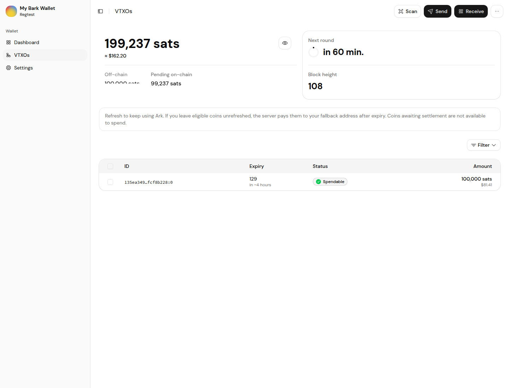
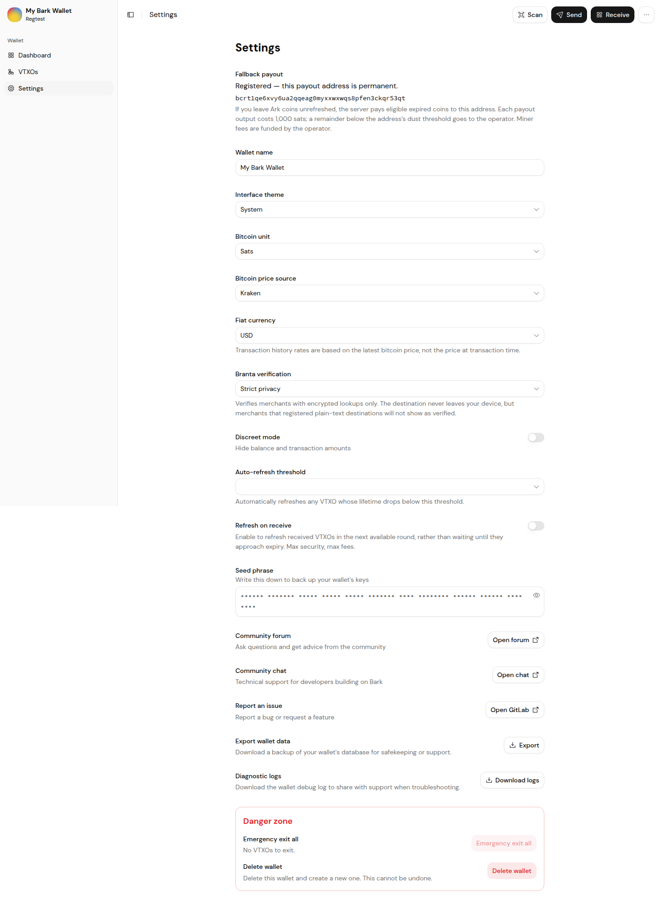
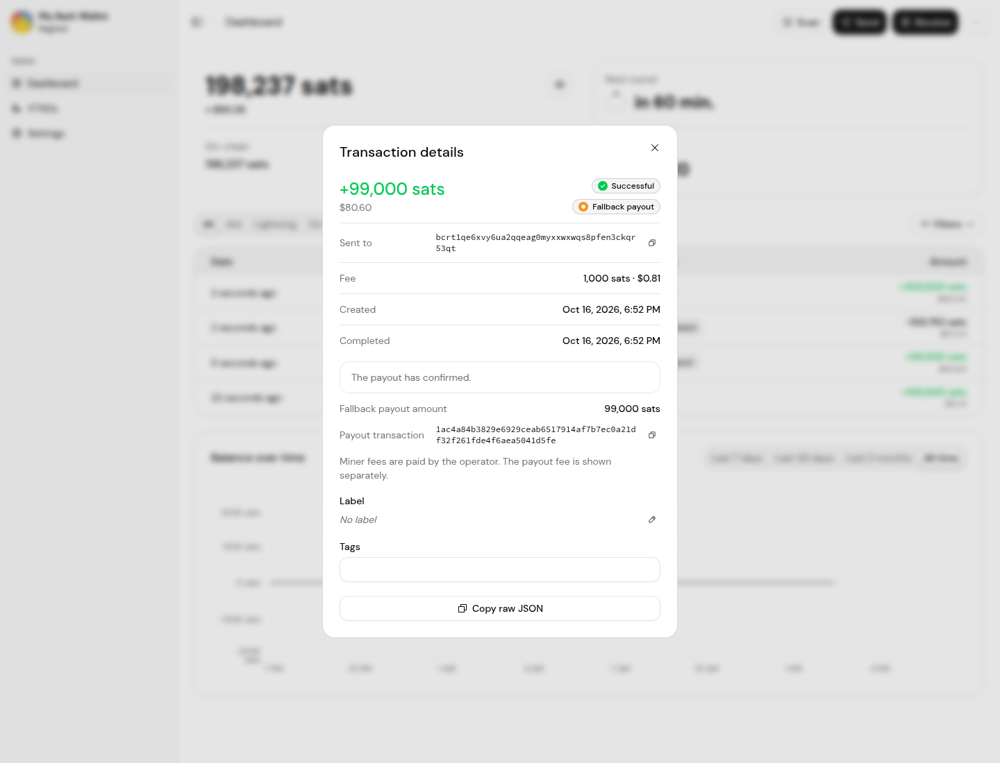
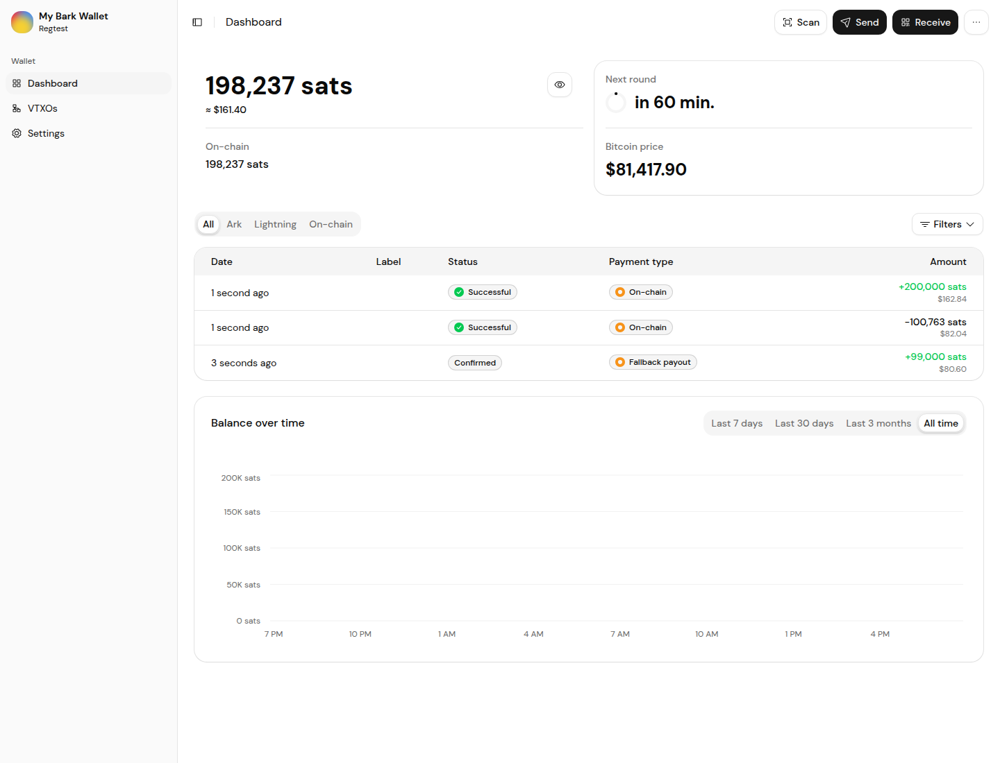
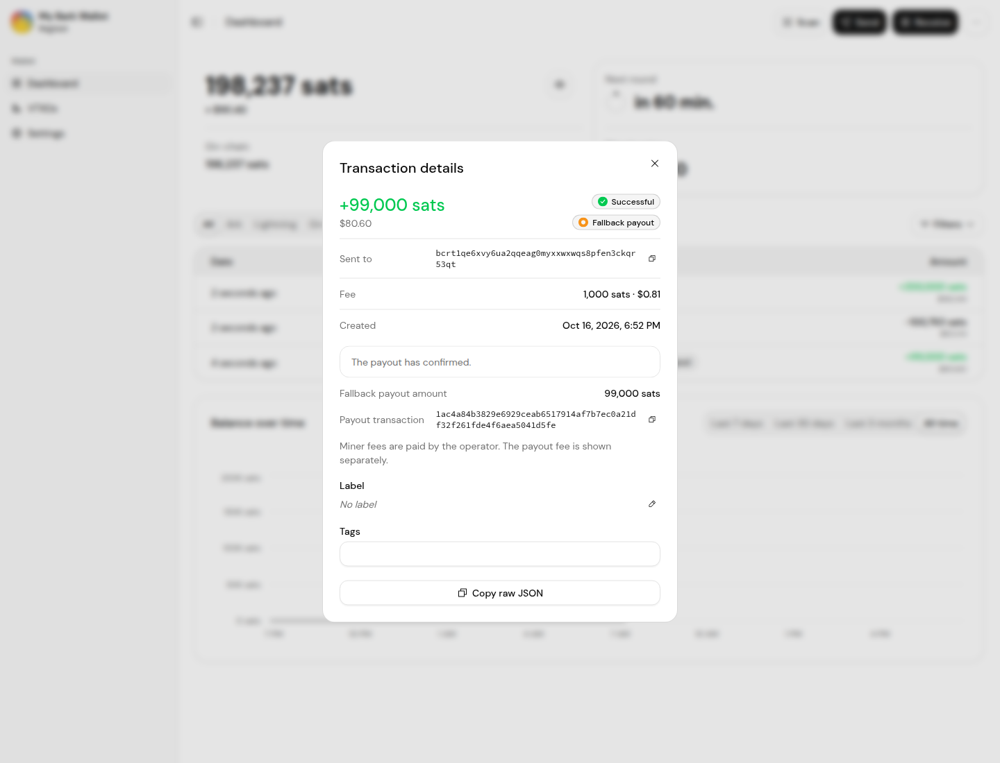

# Native fallback browser acceptance

On 2026-10-17, real Chromium and native barkd completed registration, an absent-wallet fallback payout,
and restoration into a fresh wallet database from the original seed. Nextest run
`fe405d38-4905-49d2-8224-8fabc6f9424b`: **1/1 passed in 46.016 seconds**. Browser capture passed all three phases.
No intercepted responses, synthetic receipts, or SQL financial-state writes were used.

The operator-funded payout confirmed on the fixture's Bitcoin Core chain, paid **99,000 sat**, and charged
one **1,000-sat output fee**. Returning before explicit sync produced HTTP409 with the actual typed
`decided_for_fallback` explanation. The native fixture then waited for its real confirmed receipt.
The fresh restored wallet showed the same payout and permanent address. This browser case does not sign
and spend the recovered output; that was tested separately with an attached external BIP84 wallet.

This is controlled **regtest acceptance**, separate from public-Signet campaigns. Server binaries are
pinned to `7055d1fce`; rebuilt clients include published `bd92e4574` plus the explicitly recorded backend
working overlay. Web product source remains `10ecfb9`. Exact source/archive/product/test hashes and
public transaction evidence are in [the manifest](fallback-browser-20261017/manifest.json) and
[browser evidence](fallback-browser-20261017/browser-evidence.json).

## Observed screens

## Limits and retained failures

Two earlier actual attempts exposed returning-wallet HTTP500 failures; the typed anyhow-context fix is
published in `bd92e4574` and passed the full workspace unit suite. The first run with those rebuilt clients
passed the true payout/HTTP409 checks but timed out waiting for the registration settings text in Chromium
after restart. That failure is retained; its intermittent cause remains unresolved. One bounded same-pin
retry added failure screenshot, console, URL-path and API-status capture, and completed successfully.

K3a client protection is still incomplete: a server-reported spend must retain exit protection until the
client independently checks chain discharge, including reorgs and the act-by deadline. That implementation
and its unfunded-watchman/reorg test are being developed separately. This result does not qualify hacked-server
safety, dust/exit/offboard outcomes, load capacity, offline-server seed recovery, or production readiness.
Seed controls were masked; no mnemonic or bearer token is included in these artifacts.
